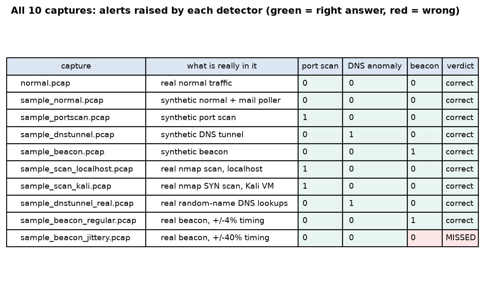
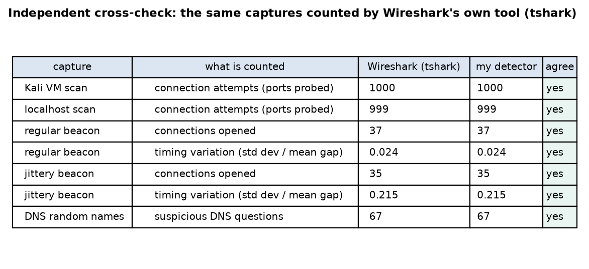
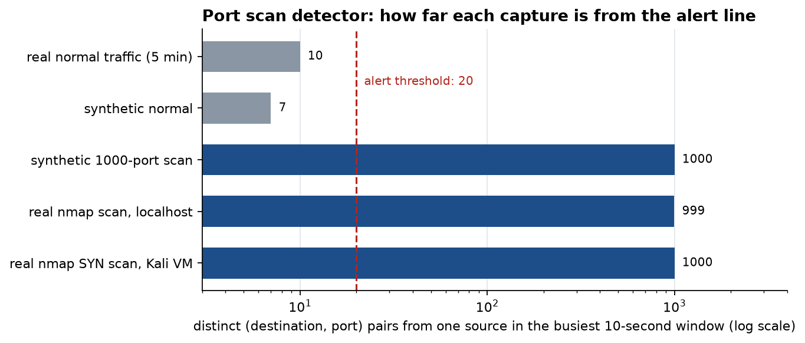
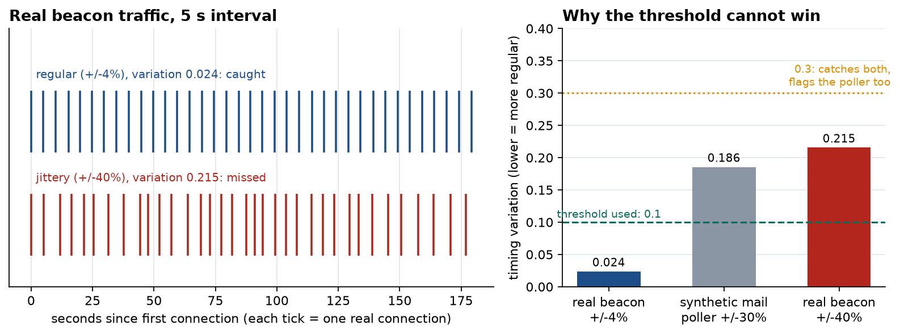
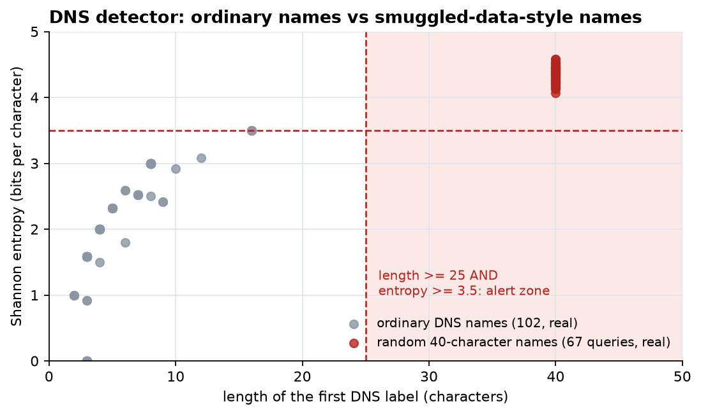
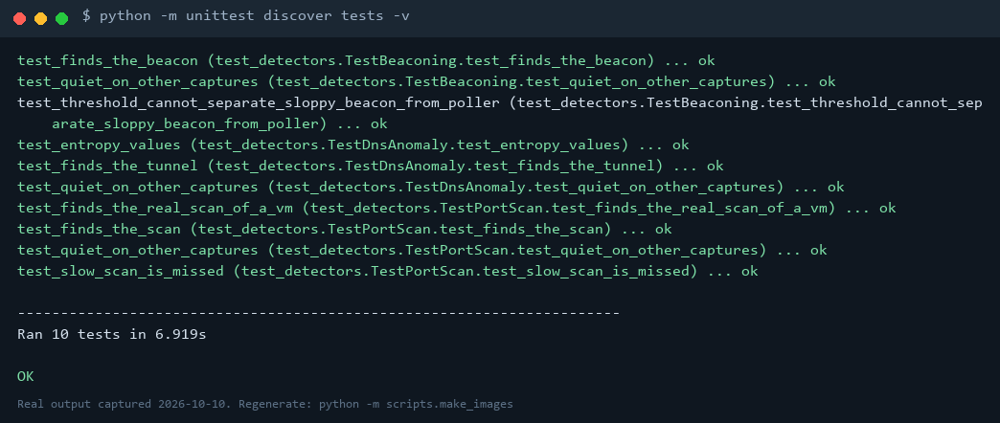
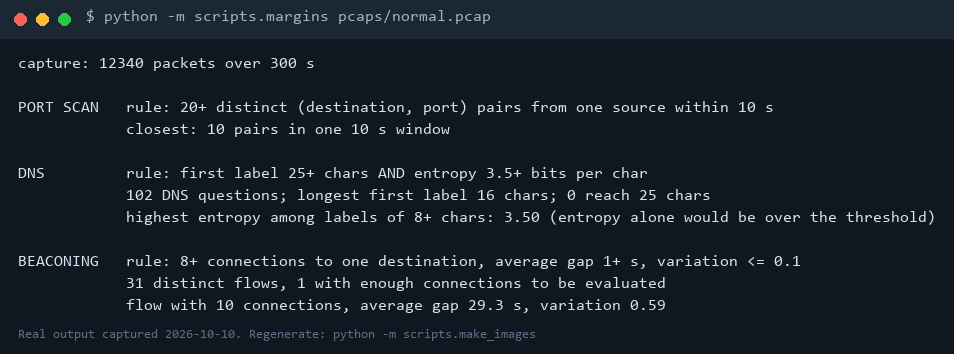

# Network Traffic Analysis

Three small Python detectors that read a packet capture and flag a port scan, DNS tunneling, or a beacon, tested on captures where I know what is inside and on real traffic from my own computer.

**Headline result:** all three detectors found their attack in both synthetic and real captures and stayed quiet on 5 minutes of real normal traffic, with one honest miss: a beacon with 40% timing jitter slipped past the timing rule, and loosening the rule enough to catch it also flags an ordinary mail-polling program. Details, margins and limitations are in [results/REPORT.md](results/REPORT.md).

> Scope: everything was captured on my own computer or my own virtual machine. Nothing was scanned or sent to anyone else's systems.

## What's here

| Path | What it does |
| --- | --- |
| `scripts/stats.py` | Packet counts, protocols, top talkers for a capture |
| `scripts/port_scan.py` | Detector: 20+ different ports from one source within 10 s |
| `scripts/dns_anomaly.py` | Detector: long, random-looking DNS names sent to one domain |
| `scripts/beaconing.py` | Detector: very regular connection timing to one destination |
| `scripts/run_detectors.py` | Runs all three on many captures, writes `results/detector_results.csv` |
| `scripts/sensitivity.py` | Shows how the beacon threshold changes what is caught |
| `scripts/margins.py` | Shows how close a capture came to each threshold (output for the real normal capture: `results/normal_margins.txt`) |
| `scripts/capture.py` | Records traffic to a `.pcap` (works without administrator rights) |
| `scripts/make_sample_pcaps.py` | Builds synthetic captures with known contents |
| `scripts/beacon_sim.py`, `dns_tunnel_sim.py`, `generate_browsing.py` | Create the test traffic on purpose |
| `scripts/extract_samples.py` | Cuts the committed `sample_*.pcap` files out of raw captures |
| `pcaps/` | The committed samples. Raw captures stay out of git (they can contain other programs' traffic) |
| `tests/` | 10 tests that check each detector against captures with known contents |

[EXPLAINED.md](EXPLAINED.md) explains each detector and the questions you may be asked.

## Evidence at a glance

Every image below is generated by `python -m scripts.make_images` from the capture files or from real command output; none is drawn by hand. The index of all the evidence is [evidence/README.md](evidence/README.md).

**All detectors on all captures** (green = right answer; the one red cell is the real miss):



**Independent check.** The same captures counted by Wireshark's own command-line tool, `tshark`, agree with my detectors on every row:



**How far normal traffic is from the alert line** (port scan detector):



**The beacon detector's trade-off.** The jittery beacon is missed; loosening the threshold enough to catch it also flags an ordinary polling program:



**DNS names:** ordinary names versus smuggled-data-style names:



**Real command output** (tests, and the margins on the real normal capture):




Note: the localhost scan shows 999 probes, not 1000. nmap reported port 137 as filtered and no packet for it appears in the capture. Wireshark and my detector both count 999.

## Run it

Needs Python 3.12 and [Npcap](https://npcap.com) (installed with Wireshark) for capturing. The detectors only need Scapy.

```
python -m venv .venv
.venv\Scripts\pip install -r requirements.txt
python scripts/make_sample_pcaps.py
python scripts/port_scan.py pcaps/sample_portscan.pcap
python -m scripts.run_detectors pcaps/sample_*.pcap
python -m unittest discover tests
```
